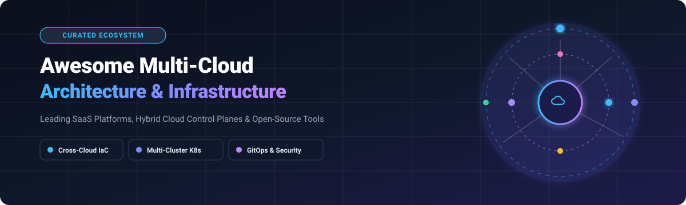

  

  

# 🌐 Awesome Multi-Cloud Architecture & Infrastructure ☁️

**A definitive curated catalog of Enterprise SaaS Platforms, Hybrid Cloud Control Planes, and Open-Source Tools.**  
*Empowering platform engineers, cloud architects, and SREs to architect, orchestrate, deploy, and govern workloads seamlessly across AWS, Azure, Google Cloud (GCP), on-premises data centers, and edge environments.*

---

## 📑 Table of Contents
- [📌 Sector Overview & Market Dynamics](#-sector-overview--market-dynamics)
- [🏢 SaaS & Managed Enterprise Platforms](#-saas--managed-enterprise-platforms)
- [🚀 Open-Source GitHub Projects](#-open-source-github-projects)
- [📈 Star History](#-star-history)
- [🤝 How to Contribute](#-how-to-contribute)
- [💖 Support](#-support)
- [⚖️ Disclaimer](#️-disclaimer)

---

## 📌 Sector Overview & Market Dynamics

The global multi-cloud management market is valued at approximately **$12.5 billion in 2025/2026** and is projected to expand at a compound annual growth rate (CAGR) of over **26% to exceed $45 billion by 2032**. 

The sector is **moderately fragmented**: hyper-scale cloud providers (Microsoft, Alphabet/Google, Amazon) dominate native extension planes, while major enterprise infrastructure titans (Broadcom/VMware, IBM/Red Hat, Nutanix) and category-defining independent innovators (HashiCorp, Morpheus Data, Platform9) fiercely compete on vendor-neutral orchestration, FinOps, policy governance, and developer self-service autonomy.

---

## 🏢 SaaS & Managed Enterprise Platforms

The table below catalogs premier multi-cloud management platforms, sorted in descending order by parent company size (valuation / annual revenue):

| Platform | Company Valuation / Revenue | Description | Starting Tier Pricing | Free Tier / Trial Limits |
| :--- | :--- | :--- | :--- | :--- |
| **[Azure Arc](https://azure.microsoft.com/en-us/products/azure-arc/)** | ~$3.1 Trillion market cap (Microsoft) / $245B+ revenue | Microsoft's multi-cloud & hybrid management plane extending Azure Resource Manager, governance, and services to any infrastructure. | Basic control plane features free; Pay-as-you-go from **$0.12/vCPU-hour** for Arc-enabled data services & $0.005/server/hour for extended update policies. | **Always Free** for core Arc server/K8s control plane management; Azure Free Account includes **$200 credit for 30 days** + 55+ services free for 12 months. |
| **[AWS Outposts](https://aws.amazon.com/outposts/)** | ~$2.0 Trillion market cap (Amazon) / $620B+ revenue | Fully managed hybrid infrastructure delivering native AWS services, APIs, and tooling directly to on-premises data centers and edge nodes. | Hardware rack/server lease starting from **~$4,500/month** (3-year term commitment, varies by rack configuration). | **No standalone hardware free tier**; AWS Cloud Free Tier provides **12 months free** on select EC2 micro instances + $300 credit promotions for qualifying enterprise hybrid evaluations. |
| **[Google Anthos](https://cloud.google.com/anthos)** | ~$2.0 Trillion market cap (Alphabet) / $350B+ revenue | Google's hybrid and multi-cloud container orchestration platform built on GKE with unified configuration management and Anthos Service Mesh. | Pay-as-you-go pricing from **$0.00822/vCPU-hour** ($6/vCPU/month) or upfront 1-3 year subscription commitments. | **$300 free credits for 90 days** on Google Cloud Platform with full Anthos evaluation capabilities and access to GCP always-free tier products. |
| **[Salesforce Hyperforce](https://www.salesforce.com/)** | ~$270 Billion market cap / $38B+ revenue | Public cloud architectural foundation enabling Salesforce applications to run natively across multi-cloud infrastructure (AWS, Azure, GCP) with strict data residency. | Included with Salesforce Enterprise editions starting at **$165/user/month** (Sales Cloud Enterprise tier). | **30-day full-featured free trial** for Salesforce Enterprise (Hyperforce-supported) with pre-configured sample workflows and no credit card required. |
| **[VMware Cloud](https://www.vmware.com/cloud-solutions.html)** | ~$61 Billion acquisition (Broadcom, $700B+ market cap) | Enterprise multi-cloud stack running VMware Cloud Foundation (VCF) and vSphere workloads natively on AWS, Azure, Google Cloud, and sovereign clouds. | Annual subscription licenses from **~$350/core/year** for VMware Cloud Foundation bundles (portable across clouds). | **60-day evaluation trial** via VMware Hands-on Labs (HOL) with 100% cloud-hosted virtual lab environments at zero cost. |
| **[Red Hat OpenShift Cloud](https://www.redhat.com/en/technologies/cloud-computing/openshift)** | ~$34 Billion acquisition (IBM, $210B+ market cap) | Comprehensive multi-cloud enterprise Kubernetes platform featuring unified developer workflows, GitOps, and service mesh consistency across clouds. | Managed OpenShift services (ROSA / ARO) starting at **$0.076/hour per 4 vCPU worker node** + underlying cloud infrastructure costs. | **60-day self-managed evaluation trial** on Red Hat Hybrid Cloud Console with full cluster features, plus $300 cloud credits on ROSA/ARO initial launches. |
| **[HashiCorp Terraform Cloud](https://www.hashicorp.com/products/terraform)** | ~$35 Billion acquisition (IBM) / $600M+ revenue | Managed infrastructure-as-code collaboration platform providing remote state, automated runs, drift detection, and Sentinel policy enforcement across clouds. | Paid Standard tier starting from **$0.00014/managed resource/hour** (Standard tier, approx. $0.10/resource/month). | **Free for up to 500 managed resources forever**; includes remote state management, VCS integration, and structured run plans without time limits. |
| **[Nutanix Cloud Platform](https://www.nutanix.com/)** | ~$16 Billion market cap / $2.1B+ revenue | Hybrid multi-cloud hyperconverged infrastructure solution enabling single-pane orchestration across private datacenters and AWS/Azure bare-metal instances. | Nutanix Cloud Clusters (NC2) software pricing starting at **$0.55/core-hour** or 1-year capacity reservations. | **30-day free test drive** hosted in Nutanix cloud sandbox with guided architectural scenarios and no hardware setup needed. |
| **[Morpheus Data](https://morpheusdata.com/)** | ~$350M–$500M estimated valuation (acquired by HPE) | Self-service multi-cloud orchestration and automation control plane featuring cost optimization (FinOps), RBAC, and catalog provisioning. | Commercial licensing starting at **~$150/workload element/year** (Enterprise Edition volume pricing). | **Community Edition free forever for up to 25 workloads/sockets**, with access to self-service provisioning, multi-cloud catalog, and basic governance. |
| **[Platform9](https://platform9.com/)** | ~$100M+ estimated valuation / $20M+ revenue | SaaS-managed Kubernetes control plane delivering zero-touch operations, automated upgrades, and monitoring across multi-cloud and bare-metal nodes. | Growth/Enterprise tier starting from **$15/node/month** (annual agreement) with 24/7 SLA-backed cluster support. | **30-day fully functional free trial** supporting up to 3 clusters and unlimited worker nodes in your choice of cloud or local environment. |

---

## 🚀 Open-Source GitHub Projects

Explore the leading open-source frameworks, control planes, and tools powering vendor-neutral multi-cloud architectures. Sorted in descending order by **GitHub Star Count**:

1. **[Kubernetes](https://github.com/kubernetes/kubernetes)**   
   The foundational, de facto open-source container orchestration platform for portable workload scheduling across public clouds, private datacenters, and edge environments. *(Apache 2.0)*

2. **[Grafana](https://github.com/grafana/grafana)**   
   The open and composable observability and data visualization platform across multi-cloud environments, unifying Prometheus, Loki, Elasticsearch, and cloud metrics. *(AGPL-3.0)*

3. **[Prometheus](https://github.com/prometheus/prometheus)**   
   Leading CNCF monitoring system and time-series database providing robust scraping, query capabilities (PromQL), and alerting for hybrid and multi-cloud infrastructure. *(Apache 2.0)*

4. **[Terraform](https://github.com/hashicorp/terraform)**   
   HashiCorp's declarative infrastructure-as-code CLI supporting thousands of cloud providers to safely and predictably codify multi-cloud resources. *(BUSL-1.1)*

5. **[Istio](https://github.com/istio/istio)**   
   Cloud-native service mesh providing transparent traffic management, mTLS security, and policy-driven routing across heterogeneous multi-cloud Kubernetes clusters. *(Apache 2.0)*

6. **[HashiCorp Vault](https://github.com/hashicorp/vault)**   
   Industry standard for multi-cloud secrets management, encryption as a service, dynamic access tokens, and privileged credential governance. *(BUSL-1.1)*

7. **[Backstage](https://github.com/backstage/backstage)**   
   Open-source internal developer portal (IDP) developed by Spotify to unify services, documentation, and infrastructure across heterogeneous multi-cloud setups. *(Apache 2.0)*

8. **[K3s](https://github.com/k3s-io/k3s)**   
   Lightweight, highly optimized certified Kubernetes distribution packaged as a single binary, ideal for edge, remote branch, and lightweight multi-cloud nodes. *(Apache 2.0)*

9. **[OpenTofu](https://github.com/opentofu/opentofu)**   
   Community-driven, genuinely open-source fork of Terraform under the Linux Foundation for declarative multi-cloud infrastructure provisioning. *(MPL-2.0)*

10. **[Rancher](https://github.com/rancher/rancher)**   
    Complete enterprise container management platform offering centralized cluster lifecycle operations, unified RBAC, and security policies across all clouds. *(Apache 2.0)*

11. **[Pulumi](https://github.com/pulumi/pulumi)**   
    Infrastructure-as-code SDK allowing developers to compose and deploy multi-cloud infrastructure using real programming languages (TypeScript, Python, Go, C#). *(Apache 2.0)*

12. **[Cilium](https://github.com/cilium/cilium)**   
    eBPF-powered networking, security, and observability engine providing cluster mesh connectivity across multi-cloud Kubernetes clusters with high performance. *(Apache 2.0)*

13. **[Argo CD](https://github.com/argoproj/argo-cd)**   
    Declarative GitOps continuous delivery tool for Kubernetes, synchronizing application manifests across hundreds of remote clusters across diverse clouds. *(Apache 2.0)*

14. **[Rook](https://github.com/rook/rook)**   
    Cloud-native open-source storage orchestrator for Kubernetes, turning distributed Ceph storage into self-managing storage services across multi-cloud deployments. *(Apache 2.0)*

15. **[Infracost](https://github.com/infracost/infracost)**   
    FinOps intelligence tool giving engineers real-time cloud cost estimates for Terraform & OpenTofu pull requests before provisioning multi-cloud infra. *(Apache 2.0)*

16. **[Open Policy Agent (OPA)](https://github.com/open-policy-agent/opa)**   
    General-purpose policy engine with Rego query language for unifying policy enforcement and compliance guardrails across multi-cloud tech stacks. *(Apache 2.0)*

17. **[Crossplane](https://github.com/crossplane/crossplane)**   
    Cloud-native control plane framework extending Kubernetes CRDs to provision and manage cross-cloud databases, networks, and services seamlessly. *(Apache 2.0)*

18. **[Talos Linux](https://github.com/siderolabs/talos)**   
    Modern, secure, and immutable Linux operating system engineered strictly for Kubernetes, running identically on AWS, GCP, Azure, and bare metal. *(MPL-2.0)*

19. **[Velero](https://github.com/vmware-tanzu/velero)**   
    Backup, disaster recovery, and cross-cluster migration utility for Kubernetes applications and persistent volumes across cloud environments. *(Apache 2.0)*

20. **[Falco](https://github.com/falcosecurity/falco)**   
    De facto cloud-native runtime security monitor detecting anomalous behaviors, security threats, and unauthorized kernel activity across multi-cloud clusters. *(Apache 2.0)*

21. **[Flux](https://github.com/fluxcd/flux2)**   
    Extensible GitOps toolkit for keeping multi-cluster and multi-cloud Kubernetes clusters in sync with Git repositories and OCI artifacts. *(Apache 2.0)*

22. **[OpenBao](https://github.com/openbao/openbao)**   
    Community-driven open-source fork of Vault under the Linux Foundation for managing, storing, and distributing secrets across multi-cloud environments. *(MPL-2.0)*

23. **[Kyverno](https://github.com/kyverno/kyverno)**   
    Kubernetes-native policy management engine for validating, mutating, generating configurations, and verifying image supply chain security without Rego. *(Apache 2.0)*

24. **[Longhorn](https://github.com/longhorn/longhorn)**   
    Cloud-native distributed block storage built on and for Kubernetes, providing replication and cross-region snapshots across multi-cloud nodes. *(Apache 2.0)*

25. **[OpenTelemetry Collector](https://github.com/open-telemetry/opentelemetry-collector)**   
    Vendor-agnostic proxy to receive, process, and export telemetry data (traces, metrics, logs) from distributed multi-cloud services. *(Apache 2.0)*

26. **[KubeVirt](https://github.com/kubevirt/kubevirt)**   
    Kubernetes virtualization add-on allowing teams to run and manage legacy virtual machines side-by-side with containers across hybrid clouds. *(Apache 2.0)*

27. **[Kubecost (Cost Model)](https://github.com/kubecost/cost-model)**   
    Real-time cost monitoring, allocation, and capacity optimization for multi-cloud Kubernetes workloads across AWS, GCP, and Azure. *(Apache 2.0)*

28. **[k0s](https://github.com/k0sproject/k0s)**   
    Zero-friction, single-binary Kubernetes distribution with all dependencies built in, suitable for any cloud, hybrid setup, or bare metal. *(Apache 2.0)*

29. **[OpenStack](https://github.com/openstack/openstack)**   
    Ubiquitous open-source cloud operating system controlling large pools of compute, storage, and networking resources across enterprise private clouds. *(Apache 2.0)*

30. **[Karmada](https://github.com/karmada-io/karmada)**   
    Cloud-native multi-cloud and multi-cluster Kubernetes orchestration system providing automated application failover and cross-cloud scheduling. *(Apache 2.0)*

31. **[Harvester](https://github.com/harvester/harvester)**   
    Open-source hyperconverged infrastructure (HCI) built on Kubernetes and KubeVirt for private and edge multi-cloud virtualization. *(Apache 2.0)*

32. **[Cluster API](https://github.com/kubernetes-sigs/cluster-api)**   
    Kubernetes subproject bringing declarative, Kubernetes-style APIs to cluster creation, configuration, and management across AWS, Azure, GCP, and vSphere. *(Apache 2.0)*

33. **[Apache CloudStack](https://github.com/apache/cloudstack)**   
    High-availability, turnkey open-source Infrastructure-as-a-Service (IaaS) cloud computing platform deployed worldwide for hybrid cloud services. *(Apache 2.0)*

34. **[Submariner](https://github.com/submariner-io/submariner)**   
    High-performance network engine enabling direct cross-cluster pod-to-pod and service-to-service communication across diverse clouds and datacenters. *(Apache 2.0)*

35. **[KubeFed](https://github.com/kubernetes-sigs/kubefed)** [?style=social&color=white)](https://github.com/kubernetes-sigs/kubefed/stargazers)  
    Kubernetes Cluster Federation project coordinating configuration, deployment, and health monitoring of workloads across multi-region clusters. *(Apache 2.0)*

36. **[OpenNebula](https://github.com/OpenNebula/one)**   
    Simple yet enterprise-ready cloud management platform delivering flexible multi-provider edge cloud and hybrid cloud computing orchestration. *(Apache 2.0)*

37. **[Open Cluster Management](https://github.com/open-cluster-management-io/ocm)**   
    Modular, CNCF sandbox multi-cluster management engine delivering unified workload distribution, policy validation, and global multi-cloud governance. *(Apache 2.0)*

---

## 📈 Star History

---

## 🤝 How to Contribute

Contributions are welcome and appreciated! To help keep this ecosystem up to date:

1. 🍴 **Fork** this repository.
2. 🌿 **Create a branch** for your updates (`git checkout -b feat/add-awesome-tool`).
3. ✍️ **Add or edit entries** following the established format:
   - For **SaaS**: Include the platform name, company valuation/revenue, concise description, specific starting price, and specific free tier / trial terms.
   - For **Open-Source**: Include the repository link, star badge (`style=social&color=white`), concise description, and open-source license.
4. 🚀 **Submit a Pull Request** with a clear explanation of why the tool is a valuable addition to multi-cloud infrastructure.

⭐ **Don't forget to star the repository if you found it useful!**

---

## 💖 Support

Thank you for exploring this multi-cloud ecosystem guide! If you find this resource helpful, please consider supporting the project:

- ⭐ **Star this repository** to improve visibility for the cloud architecture community.
- 🍴 **Fork & share** it with your engineering colleagues and DevOps groups.
- ☕ **Buy me a coffee / Sponsor**: Show extra love on the [GitHub Sponsors Dashboard](https://github.com/sponsors/ishandutta2007)!

---

## ⚖️ Disclaimer

- This repository is a **community-curated** catalog for educational and architectural evaluation purposes — inclusion does not imply an official endorsement.
- All product names, logos, and brands are property of their respective owners.
- Multi-cloud architectures must adhere to enterprise data protection mandates (GDPR, HIPAA, CCPA), industry compliance frameworks (SOC 2, ISO 27001), and cloud provider terms of service.
- Self-hosted open-source deployments require appropriate security hardening, high-availability replication, and continuous platform engineering maintenance.

---

  <b>Built with ❤️ for platform engineers, cloud architects, SREs, and DevOps professionals building the next generation of resilient multi-cloud infrastructure.</b>

